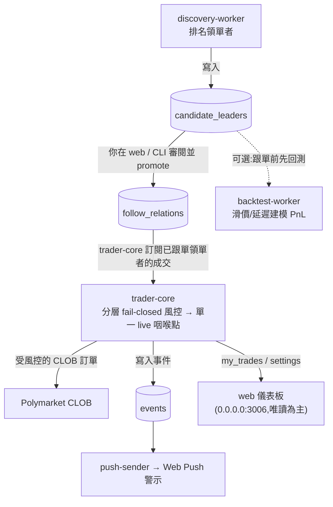

# PolyEcho

PolyEcho 是一套個人化的 Polymarket 跟單交易系統：發掘優質的領單者、
以滑價／延遲模型對其進行回測，並在完整的風險控管下跟單複製其交易 ——
全程自我託管，私鑰永不離開本機。

完整規格：[`docs/PRD.md`](docs/PRD.md)。

## Monorepo 架構

| Path                 | Component       | Description                                  |
| -------------------- | --------------- | -------------------------------------------- |
| `packages/shared`    | `polyecho.shared`    | Polymarket client、ORM 模型、db session、健康檢測 |
| `packages/core`      | `polyecho.core`      | trader-core —— 持有金鑰、簽署訂單    |
| `packages/discovery` | `polyecho.discovery` | 領單者發掘 + 評分 worker         |
| `packages/backtest`  | `polyecho.backtest`  | 滑價／延遲回測引擎          |
| `packages/push`      | `polyecho.push`      | web-push-sender（VAPID）                    |
| `packages/cli`       | `polyecho.cli`       | `polyecho` 命令列工具              |
| `packages/web`       | `@polyecho/web`      | Next.js 15 儀表板（Drizzle ORM）        |
| `infra/`             | —               | docker-compose、Dockerfiles、migrations      |

Python 套件共用隱式命名空間套件 `polyecho`（PEP 420），並以 **uv workspace**
管理。Web 應用程式則是獨立的 **pnpm workspace**。

## 運作方式



每個服務都**只透過 Postgres** 溝通 —— 沒有任何服務會對另一個服務開放連接埠。
私鑰**只**存在於 `trader-core`；控制流程是透過將資料列寫入 `settings`
資料表來達成（經由 CLI 或 web 的 `/settings` 頁面），絕不會以 RPC
方式呼叫持有金鑰的程序。

## 文件與詳細流程

詳細的系統流程與架構圖解（服務拓撲、**錢包串接方式與簽章型別**、**回測流程**、**跟單流程與風控閘**、觀測性）以 Mermaid 繪製，集中於專案 **Wiki**，不在 README 內重述：

- 線上瀏覽：[Wiki → Architecture](https://github.com/yslinear/polyecho/wiki/Architecture)
- 隨碼版控：以 git submodule 掛載於 [`docs/wiki`](docs/wiki)；取得內容：

  ```bash
  git submodule update --init docs/wiki
  ```

完整產品規格見 [`docs/PRD.md`](docs/PRD.md)。

## 前置需求

- **Docker Desktop**（macOS／Windows／Linux）。這是唯一的需求 ——
  主機上不需安裝任何東西（uv、pnpm、Python、Node、Postgres）。本
  repo 的設計是完全在容器內執行。

## 快速開始

```bash
# 1. 設定 — 複製範本並依需求編輯（見下文）。
cp .env.example .env

# 2. 啟動完整 stack（Postgres + 一次性 migrate + 所有 worker + web）。
#    全新的 DB volume 會在任何 worker 啟動前自動 migrate。
docker compose -f infra/docker-compose.yml up -d

# 3. 健康檢查 — 探測設定、DB、Polymarket 端點、RPC、proxy/VPN。
docker compose -f infra/docker-compose.yml run --rm cli polyecho doctor

# 4. 開啟儀表板（受版控的 compose 將其發布於 0.0.0.0:3006）。
open http://127.0.0.1:3006   # 或 http://<host>:3006 / Tailscale
```

停止／檢視：

```bash
docker compose -f infra/docker-compose.yml ps              # service status
docker compose -f infra/docker-compose.yml logs -f core    # follow a service
docker compose -f infra/docker-compose.yml down            # stop (keep data)
docker compose -f infra/docker-compose.yml down -v         # stop + wipe DB
```

## 設定（`.env`）

`.env` 已被 git-ignore，**永不提交**。每個變數都以 `POLYECHO_`
為前綴。下列預設值是變數未設定時整個 stack 所採用的值。

| Variable | Default | Purpose |
| --- | --- | --- |
| `POLYECHO_DB_URL` | `…@db:5432/polyecho` | Python 服務使用的非同步（asyncpg）DB URL。容器內主機為 `db`。 |
| `POLYECHO_DB_URL_DRIZZLE` | `…@db:5432/polyecho` | Web 應用程式 Drizzle ORM 使用的同步 DB URL。 |
| `POLYECHO_DATASOURCE` | `fixture` | `fixture` = 離線預錄資料（安全的預設值）。`live` = 真實的 Polymarket API。 |
| `POLYECHO_POLYMARKET_CLOB_URL` | `https://clob.polymarket.com` | CLOB 訂單 API base。 |
| `POLYECHO_POLYMARKET_DATA_API_URL` | `https://data-api.polymarket.com` | 排行榜／活動／部位 API base。 |
| `POLYECHO_POLYGON_RPC_URL` | `https://polygon-rpc.com` | Polygon RPC（鏈上贖回／餘額）。 |
| `POLYECHO_POLYMARKET_CHAIN_ID` | `137` | Polygon mainnet。 |
| `POLYECHO_POLYMARKET_PROXY_URL` | _(blank = direct)_ | 套用於**所有** Polymarket 呼叫的對外 proxy（地理封鎖的因應方式）。Web 的 `/settings` 頁面會寫入一筆 `settings` DB 資料列，於執行期覆寫此值。 |
| `POLYECHO_KEY_KDF_ITERATIONS` | `600000` | 加密帳戶金鑰的 PBKDF2 回合數。通關密語以互動方式輸入，絕不儲存。 |
| `POLYECHO_VAPID_PUBLIC_KEY` / `_PRIVATE_KEY` / `_SUBJECT` | _(blank)_ | Web-push（VAPID，RFC 8292）。以 `polyecho push vapid-keygen` 產生。 |
| `POLYECHO_LIVE_TRADING` | _(unset = false)_ | **真實資金的主鎖（MASTER live-money lock）。** 為 false 時，每一筆真實訂單／贖回都會在單一咽喉點 RAISES。詳見 [上線（真實資金）](#going-live-real-money)。 |
| `POLYECHO_AUTO_REDEEM` | _(unset = false)_ | 自動領取獎金。只有在此值**與** `POLYECHO_LIVE_TRADING` 皆為 true 時才會動作。 |
| `POLYECHO_WEB_PORT` | `3000` | 容器內部的儀表板埠。**注意：** 受版控的 `infra/docker-compose.yml` 已固定將 web 發布於 `0.0.0.0:3006`（對外曝露於主機所有介面，非經此 env 預設值）。 |
| `POLYECHO_LOG_LEVEL` | `INFO` | 結構化日誌等級。 |
| `POLYECHO_TZ` | `Asia/Taipei` | 顯示時區（用於「今日」PnL 的邊界判定）。 |

> **Proxy／VPN 說明。** 若 Polymarket 遭地理封鎖，請自行架設你自己的
> VPN／proxy 作為**獨立**的事務（這是操作者的責任，不在專案範圍內），
> 並將 `POLYECHO_POLYMARKET_PROXY_URL` 指向它 —— 例如主機上執行的
> proxy 可用 `http://host.docker.internal:8888`。請勿將 proxy 加入受版控的
> compose 檔；將它保留在你私有的 `.env` 中。

## 服務

| Service | Ports | Role |
| --- | --- | --- |
| `db` | `127.0.0.1:5432` | PostgreSQL 16。僅綁定 localhost。 |
| `migrate` | — | 一次性。對健康的 DB 套用 `infra/migrations`，然後結束。每個應用程式都會等待它。 |
| `core` | **none** | trader-core。持有私鑰、簽署訂單。不開放任何連接埠（金鑰隔離）。 |
| `discovery` | none | 領單者發掘 + 評分 worker。 |
| `backtest` | none | 輪詢 `backtest_jobs`、執行引擎、寫入結果。 |
| `push` | none | Web-push 傳送器（僅對外 VAPID）。 |
| `web` | `0.0.0.0:3006` | Next.js 15 儀表板。以唯讀為主，**設計上無驗證機制**。受版控的 compose 依操作者明確決定將其曝露於主機所有介面（含 LAN／Tailscale），逾越 loopback。 |
| `cli` | — | 隨需執行（`profile: tools`）。`polyecho` 命令。 |

## CLI 參考

`polyecho` CLI 是操作者的控制介面。標準呼叫方式（對執行中 stack 的 DB
執行一個一次性容器）：

```bash
docker compose -f infra/docker-compose.yml run --rm cli polyecho <command> [args]
```

`polyecho --help` 與 `polyecho <group> --help` 會印出任一群組的完整用法。
命令群組及其命令：

### `polyecho doctor`
端到端健康檢查：驗證設定、DB 連線、Polymarket CLOB／Data API／Polygon
RPC 可達性，以及 proxy／VPN 對外連線。每當有狀況看起來不對勁時，先執行
這個。

### `polyecho account` — 交易帳戶與金鑰管理（CLI-only）
| Command | What it does |
| --- | --- |
| `set-danger-passphrase` | 設定用來加密所存金鑰的通關密語。 |
| `detect` | 從金鑰偵測／推導出帳戶位址。 |
| `import` | 匯入私鑰（靜態加密；**僅限 CLI**，絕不經由 web）。 |
| `list` | 列出已設定的帳戶。 |
| `balance` | 顯示某帳戶的鏈上／Polymarket 餘額。 |

### `polyecho discovery` — 領單者候選池
| Command | What it does |
| --- | --- |
| `run` | 立即執行一次發掘 + 評分掃描。 |
| `schedule` | 依週期排程執行發掘。 |
| `promote` | 將候選者提升進入已跟單領單者集合。 |

### `polyecho backtest` — 滑價／延遲回測引擎
| Command | What it does |
| --- | --- |
| `new` | 排入一個新的回測工作（依領單者 + 情境參數）。 |
| `list` | 列出回測工作及其狀態。 |
| `show` | 顯示某個已完成回測的結果。 |

### `polyecho trader` — trader-core 控制（DB 驅動；此處絕不持有金鑰）
| Command | What it does |
| --- | --- |
| `status` | 目前 trader-core 狀態、已跟單領單者、未平倉風險。 |
| `start` | 開始跟單某個已跟單領單者。 |
| `pause` / `resume` | 暫停／恢復單一領單者。 |
| `pause-all` / `resume-all` | 全域緊急停止／恢復。 |
| `enable-live` / `disable-live` | 切換真實資金鎖（見下文）。 |
| `skips` | 檢視被略過的跟單決策及其原因。 |
| `redeems` | 檢視領取獎金／贖回活動。 |

### `polyecho db` — 資料庫操作
| Command | What it does |
| --- | --- |
| `migrate` | 套用 migrations（stack 在啟動時會自動執行此項）。 |
| `backup` | 匯出資料庫。 |
| `reconcile` | 將 DB 狀態與鏈上／Polymarket 的真實狀態進行對帳。 |

### `polyecho logs show`
即時顯示結構化服務日誌。

### `polyecho push vapid-keygen`
為 web-push 產生一組 VAPID 公／私鑰；將值貼入 `.env`
（`POLYECHO_VAPID_*`）。

### `polyecho alerts list`
列出近期的 push 事件（即儀表板所呈現的事件日誌）。

## 典型工作流程

**發掘並審閱領單者**

```bash
docker compose -f infra/docker-compose.yml run --rm cli polyecho discovery run
# 在 http://<host>:3006/discovery 審閱候選者
docker compose -f infra/docker-compose.yml run --rm cli polyecho discovery promote <wallet>
```

**在跟單前回測某個領單者**

```bash
docker compose -f infra/docker-compose.yml run --rm cli polyecho backtest new --help
docker compose -f infra/docker-compose.yml run --rm cli polyecho backtest list
docker compose -f infra/docker-compose.yml run --rm cli polyecho backtest show <id>
```

**匯入交易金鑰（僅限 CLI，靜態加密）**

```bash
docker compose -f infra/docker-compose.yml run --rm cli polyecho account set-danger-passphrase
docker compose -f infra/docker-compose.yml run --rm cli polyecho account import
```

**啟用 web-push 警示**

```bash
docker compose -f infra/docker-compose.yml run --rm cli polyecho push vapid-keygen
# 將金鑰放入 .env，然後執行：docker compose ... up -d --force-recreate push web
```

<a id="going-live-real-money"></a>

### 上線（真實資金）

真實交易處於**硬鎖（hard-locked）**狀態。當 `POLYECHO_LIVE_TRADING`
未設定／為 false（預設值）時，每一筆 CLOB 訂單與鏈上贖回都會在單一
咽喉點觸發例外 —— 系統完全以 dry-run／fixture 模式運行，且**不會移動
任何真實資金**。要上線，你必須刻意地：

1. 為帳戶注資並匯入（`polyecho account import`）。
2. 在 `.env` 中設定 `POLYECHO_DATASOURCE=live` 與 `POLYECHO_LIVE_TRADING=true`。
3. 重新建立 stack 並武裝 trader-core：
   ```bash
   docker compose -f infra/docker-compose.yml up -d --force-recreate
   docker compose -f infra/docker-compose.yml run --rm cli polyecho trader enable-live
   docker compose -f infra/docker-compose.yml run --rm cli polyecho trader start <leader>
   ```

`polyecho trader pause-all` 是即時的全域緊急停止開關。`disable-live`
會重新啟用該鎖。

## Web 儀表板

`http://<host>:3006`（本機 `http://127.0.0.1:3006`；經 Tailscale
`http://mac-mini.tail3e1efb.ts.net:3006`）——**設計上無驗證機制**。
受版控的 `infra/docker-compose.yml` 依操作者明確且再三確認的決定，
將 web 發布於 `0.0.0.0:3006`，**曝露於主機所有網路介面（含 LAN
與 Tailscale），逾越 loopback**；此無驗證 UI 的遠端存取因而是操作者
明確接受的責任，不在專案範圍內（PRD §5.9）。它以唯讀為主：總覽、
發掘、領單者明細 + 評分圖表、回測、交易、部位、帳戶、領單者、一個
`/status` 整合健康頁面，以及一個會將 Polymarket proxy URL 寫入
`settings` 資料表的 `/settings` 頁面。

## 安全模型（不可妥協）

- `trader-core` 持有私鑰，且**不**開放任何網路連接埠。
- 私鑰**絕不**進入任何 web 程序；金鑰匯入**僅限 CLI**。
- 所有控制都透過 DB `settings` 變更流動，而非以 RPC 呼叫金鑰持有者。
- 真實交易由單一咽喉點（`assert_live_allowed`）把關；預設為
  dry-run／fixture —— 除非明確解鎖，否則不會移動任何真實資金。
- `db` 僅綁定 `127.0.0.1`。`web` 設計上沒有驗證層，且受版控的 compose
  依操作者明確決定將其發布於 `0.0.0.0:3006`、曝露於主機所有介面（含
  LAN／Tailscale，逾越 loopback）—— 此無驗證 UI 的遠端存取是操作者
  明確接受的責任（PRD §5.9）。

## 疑難排解

- **有任何東西失敗？** 先執行 `polyecho doctor` —— 它會精準定位設定、
  DB、API、RPC 與 proxy／VPN 的問題。
- **全新／空的 DB：** 一次性的 `migrate` 服務會在 worker 啟動前自動
  建立 schema；不需手動步驟。
- **遭地理封鎖的 Polymarket 呼叫：** 設定 `POLYECHO_POLYMARKET_PROXY_URL`
  （或 web `/settings` 的 proxy 欄位）—— 見上方的 proxy／VPN 說明。
- **全部重置：** `docker compose -f infra/docker-compose.yml down -v`
  會清除 DB volume；下一次 `up` 會從頭重新 migrate。
